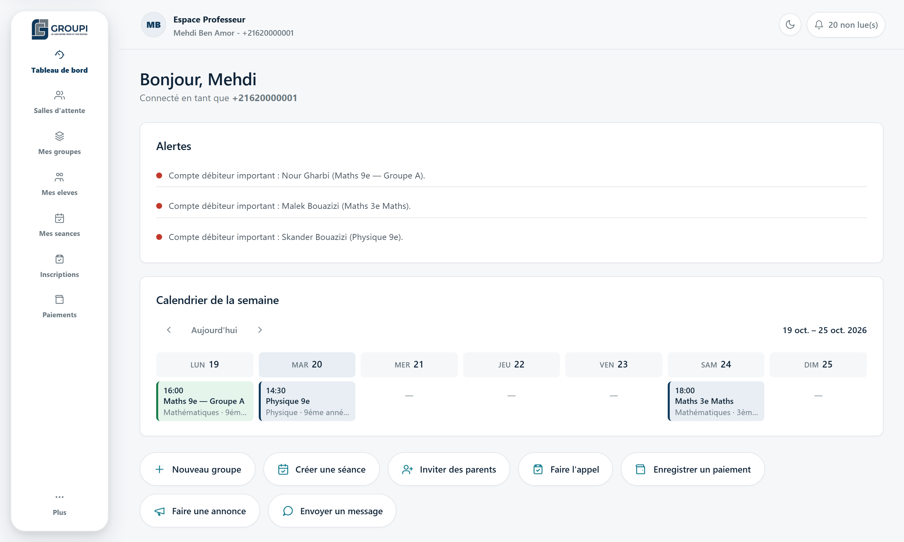
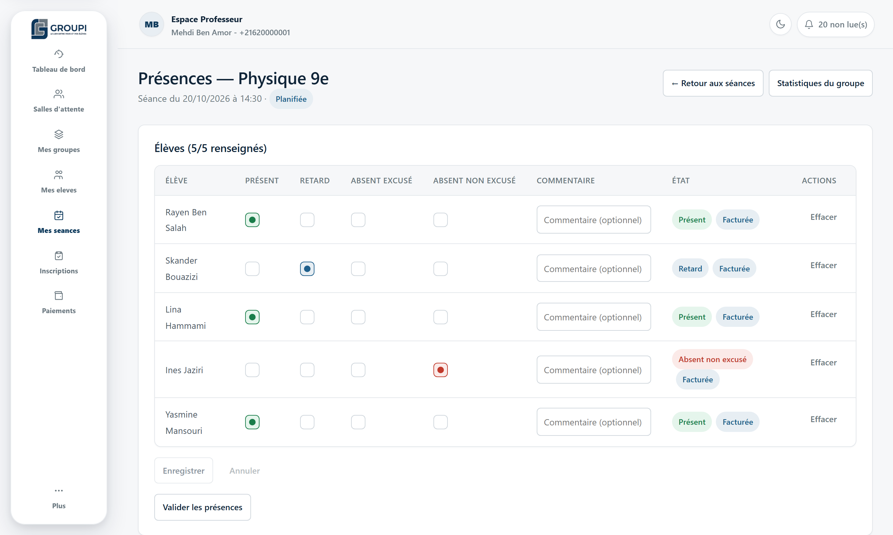
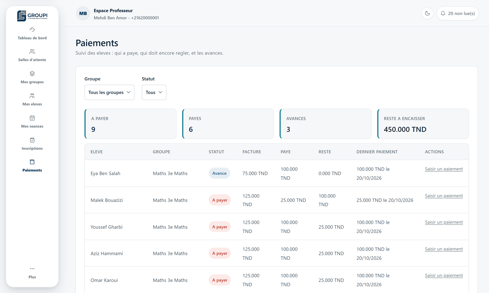
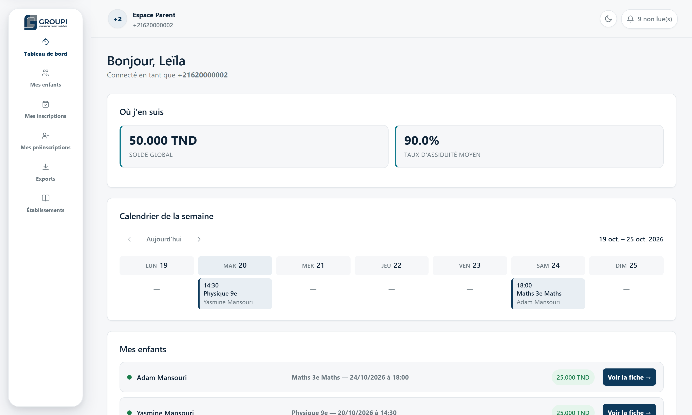
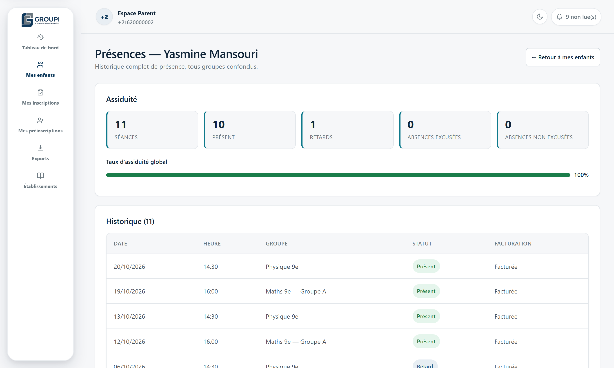
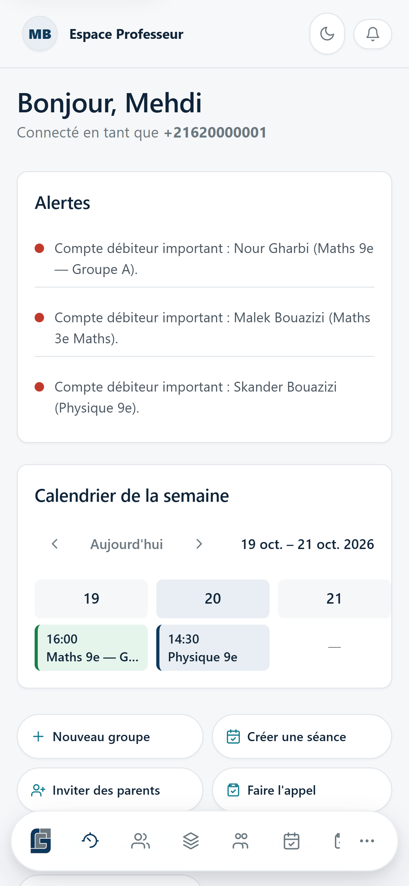
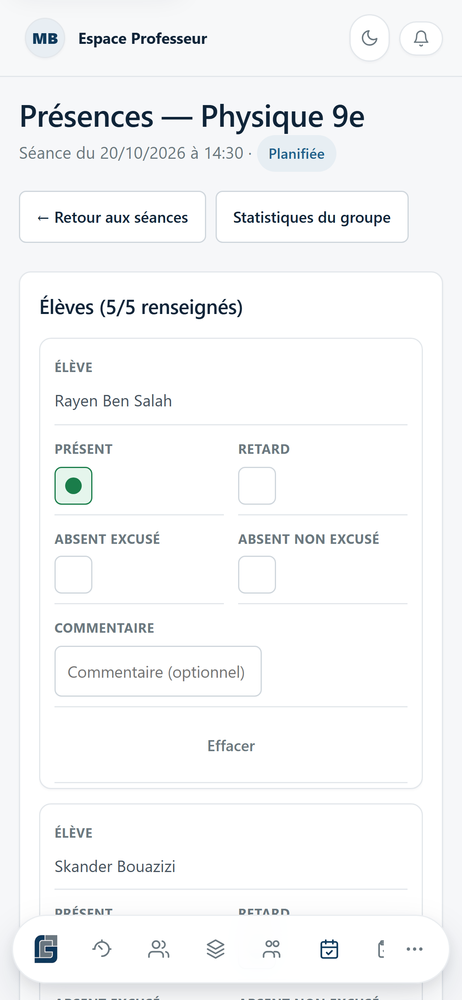
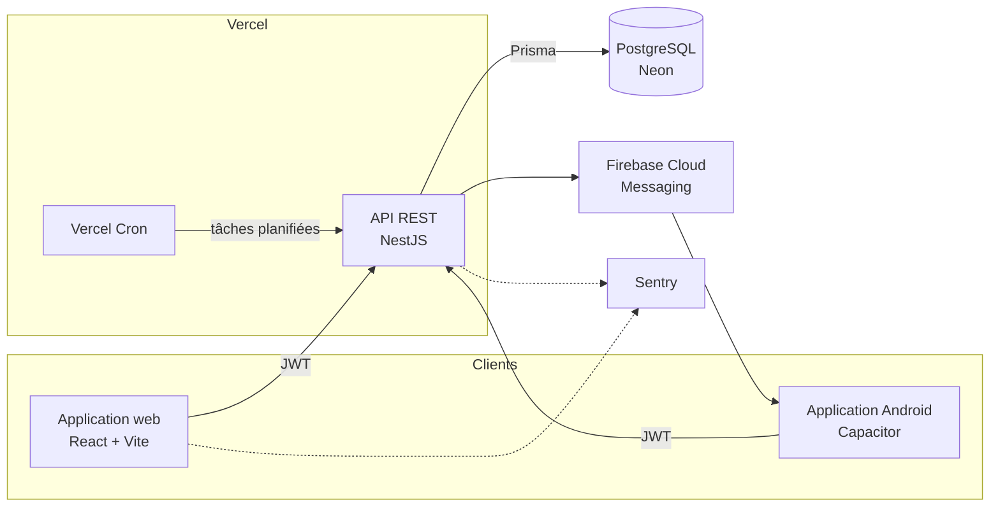

[🇬🇧 English](README.md) · 🇫🇷 Français

# GROUPI

**Une plateforme de gestion pour les professeurs de cours particuliers et les parents de leurs élèves**

Application web · Application Android · API REST

[Application en ligne](https://groupi-web.vercel.app) · [Captures d'écran](#captures-décran) · [Architecture](#architecture)

---

> **Le code source est privé.** Ce dépôt présente le projet : ce qu'il fait, comment il est construit et les choix techniques derrière. Je présente volontiers le code en entretien.

## Le problème

En Tunisie, les cours particuliers sont un marché énorme, mais la plupart des professeurs le gèrent encore avec des cahiers, des fichiers Excel, des groupes WhatsApp et des appels. Savoir qui est venu, qui a payé et combien de séances il reste prend des heures chaque semaine, et les parents n'ont presque aucune visibilité.

**GROUPI automatise ce travail administratif** pour que les professeurs se concentrent sur l'enseignement, et donne aux parents une vue claire et en temps réel des présences et du solde de leurs enfants.

## Mon rôle

J'ai conçu et développé GROUPI **de bout en bout, seul** :

- rédaction de la spécification fonctionnelle (acteurs, règles métier, workflows, cas d'erreur) et de ses avenants
- conception du modèle de données et de l'API
- développement du backend, du frontend web et de l'application Android
- mise en place de la CI, du déploiement, du monitoring et des notifications push

## Fonctionnalités

### Pour les professeurs
- **Inscription par lien d'invitation** : le professeur partage un seul lien (par WhatsApp par exemple) ; les parents s'inscrivent et arrivent dans une liste d'attente du bon niveau, puis le professeur les affecte à un groupe
- **Groupes et emplois du temps** : les séances récurrentes sont générées automatiquement
- **Présences** : appel rapide par séance, avec historique et taux d'assiduité
- **Suivi des paiements** : un solde par élève, mis à jour automatiquement à partir des séances suivies et des paiements enregistrés
- **Tableau de bord** : revenus, revenus prévus sur l'année scolaire, taux de remplissage des groupes, impayés
- **Annonces** à tout un groupe, **exports Excel/PDF** et **gestion d'abonnement** (offres gratuite, intermédiaire et pro avec limites de capacité)

### Pour les parents
- Un portail séparé, en lecture seule : groupes, présences, solde et annonces de chaque enfant
- Notifications dans l'application et push, y compris des rappels automatiques de paiement et d'absence

### Pour les administrateurs
- Validation des comptes professeurs, gestion des utilisateurs, données de référence (matières, niveaux, établissements), années scolaires, abonnements et exports

## Captures d'écran

Les captures utilisent des données de démonstration fictives. L'interface est en français, la langue de ses utilisateurs.

**Tableau de bord du professeur** : alertes sur les gros impayés, séances de la semaine et actions rapides

**Appel** : un appui par élève ; chaque statut de présence alimente automatiquement la facturation

**Suivi des paiements** : montant facturé, payé et restant dû pour chaque élève, calculé par le moteur comptable

| Portail parent | Historique de présence d'un enfant |
|---|---|
|  |  |

**Mobile** : la même application React, empaquetée pour Android avec Capacitor

  
  &nbsp;&nbsp;
  

## Architecture

- **Monorepo npm workspaces** : `apps/api` (NestJS) et `apps/web` (React)
- **L'application web et l'application Android partagent une seule base de code React** ; Capacitor l'empaquette en application native avec notifications push
- **Déploiement serverless** sur Vercel (API et frontend en deux projets), avec Postgres sur Neon
- Les **tâches planifiées** (rappels de paiement et de présence, échéances d'abonnement, résumé quotidien, purges de rétention des données) passent par Vercel Cron, sur des routes protégées par un secret partagé, et sont idempotentes

## Stack technique

| | |
|---|---|
| **Backend** | TypeScript, NestJS, Prisma, PostgreSQL, Passport/JWT, argon2 |
| **Frontend** | React 19, React Router, Vite, CSS sans framework avec son propre design system (thèmes clair/sombre) |
| **Mobile** | Capacitor (Android), Firebase Cloud Messaging |
| **Documents** | ExcelJS, PDFKit |
| **Qualité** | Jest (tests unitaires + de bout en bout sur une vraie base), ESLint, Oxlint, GitHub Actions |
| **Ops** | Vercel, Neon, Sentry, Docker (développement local) |

## Points techniques marquants

- **Développement piloté par la spécification.** Chaque règle métier a un code (`RM-*`, `CAL-*`, `ERR-*`) dans une spécification écrite, et le code s'y réfère. Quand les besoins ont changé, j'ai rédigé des avenants numérotés au lieu de modifier le comportement en silence.
- **Isolation stricte des données.** Chaque professeur ne voit que ses propres groupes et élèves, et les parents ne voient que leurs enfants. Ces règles sont appliquées côté serveur, pas seulement masquées dans l'interface.
- **Contrôle d'accès par rôle** sur 4 rôles (Super Admin, Admin, Professeur, Parent), avec délégation des permissions d'administration une par une.
- **Un moteur comptable** qui calcule le solde de chaque élève à partir des séances suivies et des paiements, avec traçabilité, si bien qu'aucun montant n'est saisi à la main.
- **Sécurité des comptes** : hachage argon2id, jetons d'accès de courte durée, déconnexion après inactivité, blocage après plusieurs échecs de connexion, identité basée sur le numéro de téléphone.
- **CI à chaque push** : migrations, lint, build, tests unitaires et tests de bout en bout sur un vrai service PostgreSQL.

## En chiffres

| | |
|---|---|
| Lignes de TypeScript | ~50 000 |
| Modèles de base de données | 51 |
| Modules backend | 25+ |
| Écrans | 40+ |
| Suites de tests automatisés | 18 |

## État du projet

Le MVP est en ligne, et les fonctionnalités arrivent par avenants versionnés à la spécification. Prochaines étapes : notifications SMS/WhatsApp et paiement en ligne.

---

Réalisé par **Anas Sfar** · [LinkedIn](https://www.linkedin.com/in/anas-sfar-331071370/) · [anassfar.fr@gmail.com](mailto:anassfar.fr@gmail.com)

