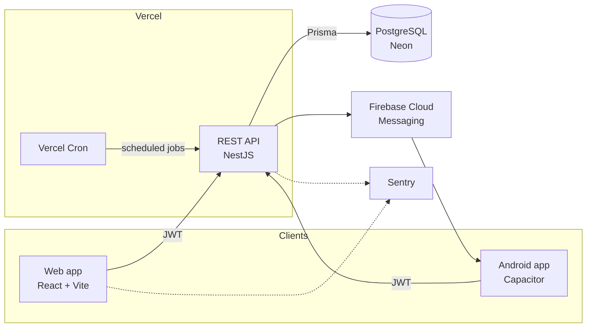

# GROUPI

**A management platform for private tutors and the parents of their students**

Web app · Android app · REST API

<!-- TODO: replace with the real URL once a read-only demo account exists -->
[Live demo](https://groupi-web.vercel.app) · [Demo video](#demo) · [Architecture](#architecture)

---

> **The source code is private.** This repository presents the project: what it does, how it is built, and the engineering decisions behind it. I'm happy to walk through the code in an interview.

## The problem

In Tunisia, private tutoring is a huge market, but most teachers still run it with paper notebooks, Excel sheets, WhatsApp groups and phone calls. Keeping track of who attended, who paid and how many sessions are left takes hours every week, and parents have little visibility.

**GROUPI automates that admin work** so teachers can focus on teaching, and gives parents a clear, real-time view of their children's attendance and balance.

## My role

I designed and built GROUPI **end to end, on my own**:

- wrote the functional specification (actors, business rules, workflows, error cases) and its later amendments
- designed the data model and the API
- built the backend, the web frontend and the Android app
- set up CI, deployment, monitoring and push notifications

## Features

### For teachers
- **Invitation link onboarding**: the teacher shares one link (e.g. via WhatsApp); parents sign up and land in a waiting pool for the right level, then the teacher assigns them to a group
- **Groups and schedules**: recurring sessions are generated automatically
- **Attendance**: fast roll call per session, with history and attendance rates
- **Payment tracking**: a per-student balance, updated automatically from attended sessions and recorded payments
- **Dashboard**: revenue, projected revenue for the academic year, group occupancy, unpaid balances
- **Announcements** to a whole group, **Excel/PDF exports**, and **subscription management** (free, intermediate and pro plans with capacity limits)

### For parents
- A separate, read-only portal: each child's groups, attendance, balance and announcements
- In-app and push notifications, including automatic payment and absence reminders

### For admins
- Teacher account validation, user management, reference data (subjects, levels, schools), academic years, subscriptions and exports

## Screenshots

<!-- TODO: add screenshots to /screenshots, ideally in light mode at the same size -->
| Teacher dashboard | Roll call | Parent portal |
|---|---|---|
|  |  |  |

| Payment tracking | Android app |
|---|---|
|  |  |

## Demo

<!-- TODO: 1–2 min video or GIF: invitation link → assignment → roll call → parent sees the update -->
*Coming soon.*

## Architecture

- **npm workspaces monorepo**: `apps/api` (NestJS) and `apps/web` (React)
- The **web app and the Android app share one React codebase**; Capacitor packages it as a native app with push notifications
- **Serverless deployment** on Vercel (API and frontend as two projects), with Postgres on Neon
- **Scheduled jobs** (payment and attendance reminders, subscription deadlines, daily digest, data-retention purges) run through Vercel Cron on routes protected by a shared secret, and are idempotent

## Tech stack

| | |
|---|---|
| **Backend** | TypeScript, NestJS, Prisma, PostgreSQL, Passport/JWT, argon2 |
| **Frontend** | React 19, React Router, Vite, plain CSS with its own design system (light/dark themes) |
| **Mobile** | Capacitor (Android), Firebase Cloud Messaging |
| **Documents** | ExcelJS, PDFKit |
| **Quality** | Jest (unit + end-to-end against a real database), ESLint, Oxlint, GitHub Actions |
| **Ops** | Vercel, Neon, Sentry, Docker (local dev) |

## Engineering highlights

- **Spec-driven development.** Every business rule has a code (`RM-*`, `CAL-*`, `ERR-*`) in a written specification, and the code refers to those codes. When requirements changed, I wrote numbered amendments instead of silently changing behaviour.
- **Strict data isolation.** Each teacher only ever sees their own groups and students, and parents only see their own children. These rules are enforced on the server, not only hidden in the UI.
- **Role-based access control** across 4 roles (Super Admin, Admin, Teacher, Parent), with admin permissions delegated one by one.
- **An accounting engine** that derives each student's balance from attended sessions and payments, with traceability, so amounts are never edited by hand.
- **Account security**: argon2id hashing, short-lived access tokens, inactivity timeout, lockout after repeated failed logins, phone-based identity.
- **CI on every push**: migrations, lint, build, unit tests and end-to-end tests against a real PostgreSQL service.

## In numbers

| | |
|---|---|
| Lines of TypeScript | ~50,000 |
| Database models | 51 |
| Backend modules | 25+ |
| Screens | 40+ |
| Automated test suites | 18 |

## Status

The MVP is live, with features rolled out through versioned amendments to the specification. Planned next: SMS/WhatsApp notifications and online payments.

---

Built by **Anas Sfar** · <!-- TODO --> [LinkedIn](https://www.linkedin.com/in/your-profile) · [anassfar.fr@gmail.com](mailto:anassfar.fr@gmail.com)

